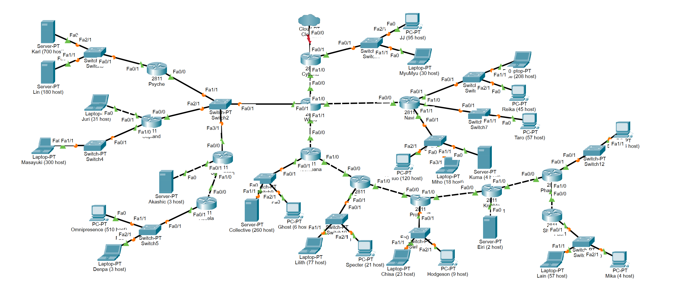
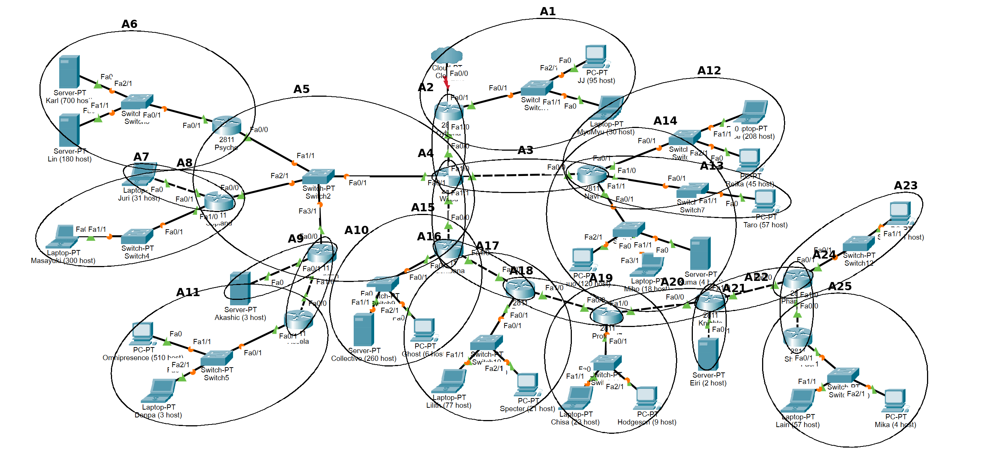
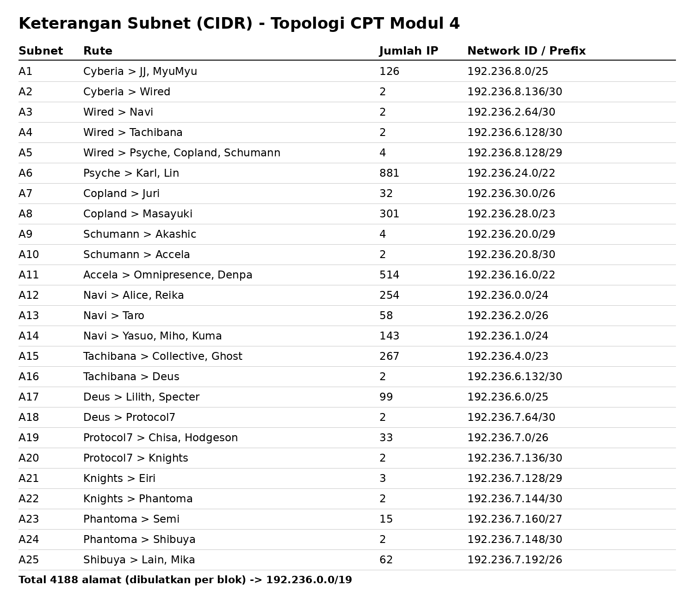
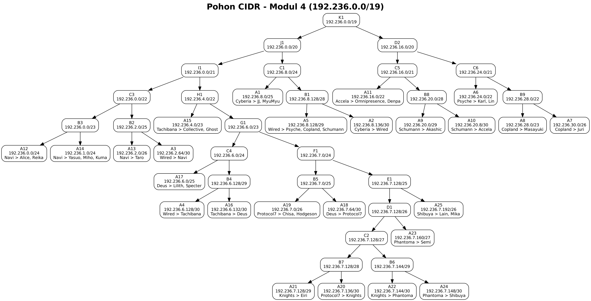
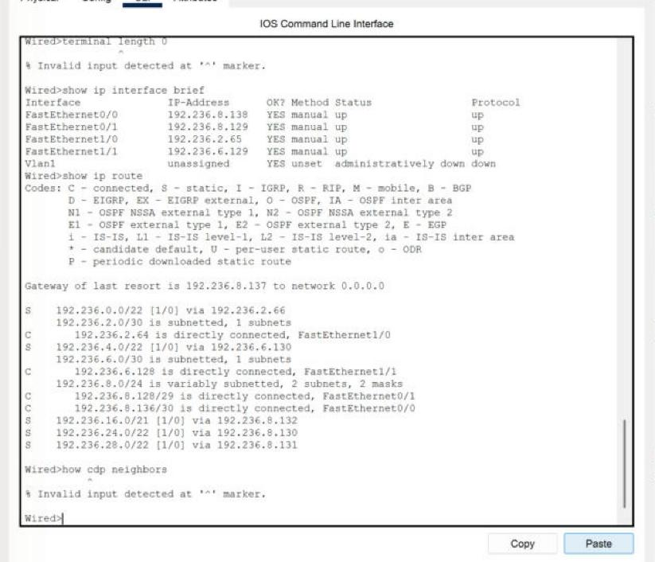
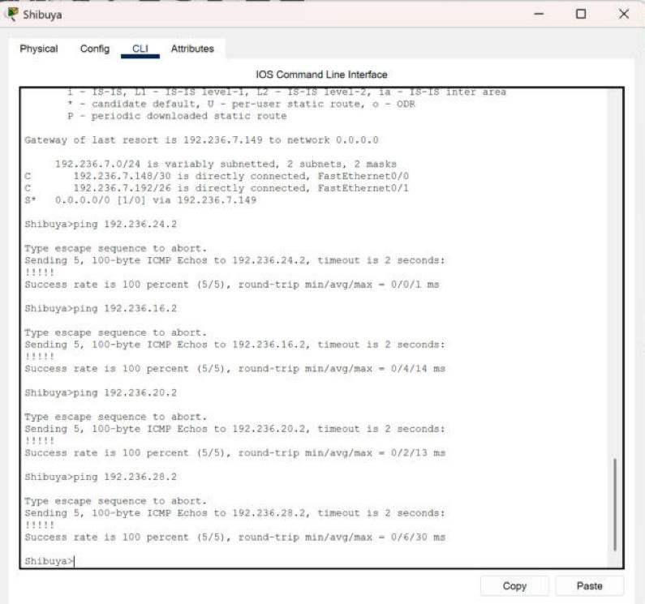
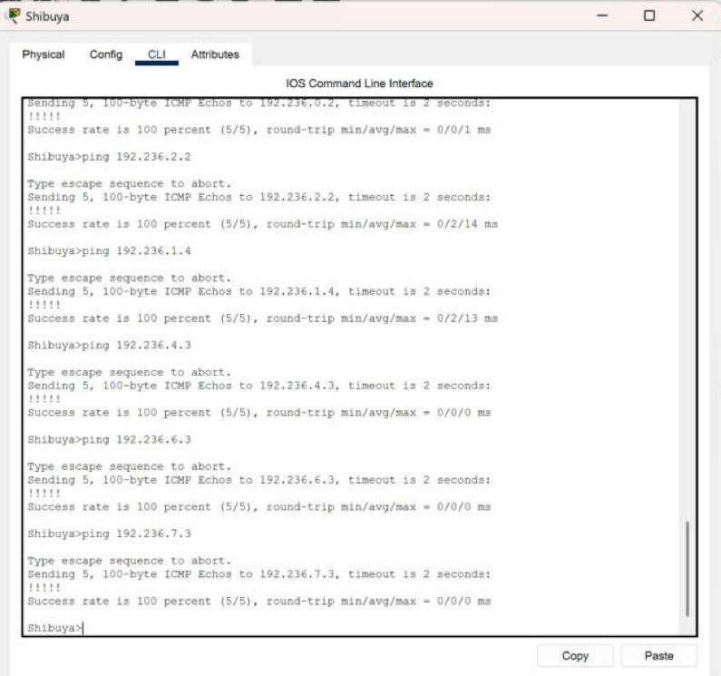
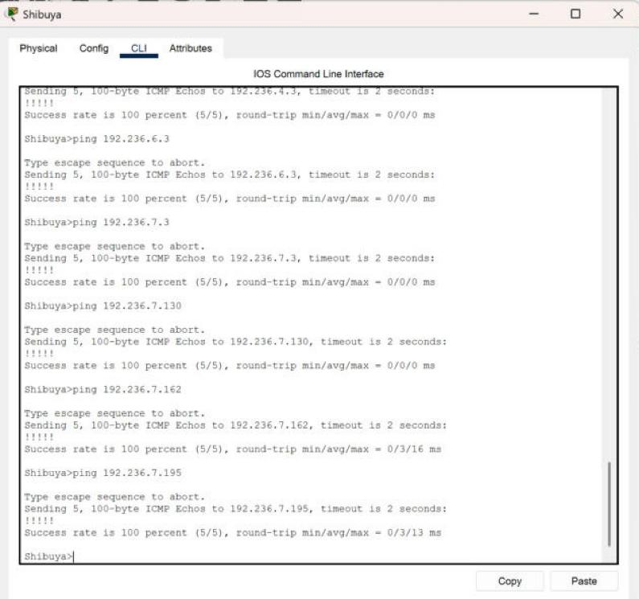
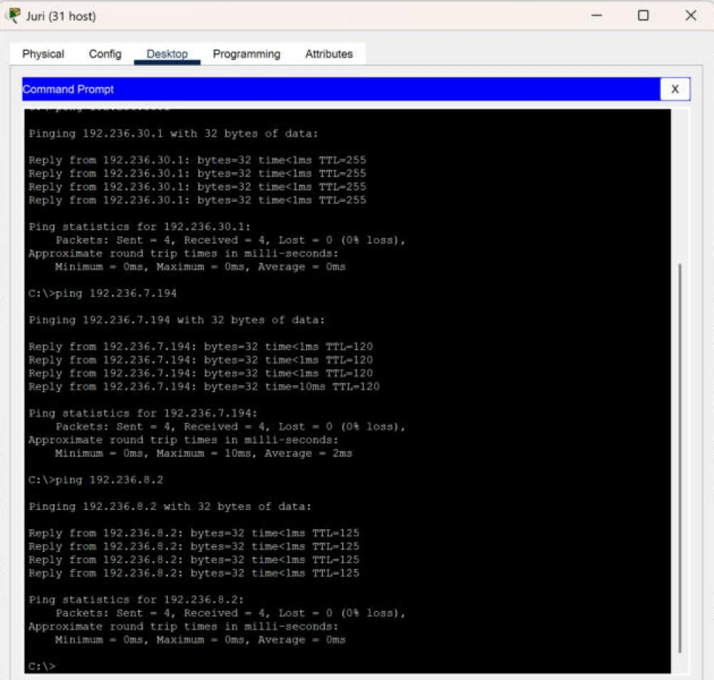

## Member

| No  | Nama                        | NRP        |
| --- | --------------------------- | ---------- |
| 1   | Marvelino Davas             | 5027251085 |
| 2   | Nathania Tiara Wahyudi      | 5027251089 | 

 ---

 ## Laporan

[LINK SPREADSHEET]
https://docs.google.com/spreadsheets/d/10rywSwr6aqeTnCBsJ5WrY3B9k7bYBrfX-y58Nblas74/edit?usp=sharing

### GNS3 - VLSM

#### 1. Topologi GNS3


#### 2. Analisis subnet dan jumlah IP

| Subnet | Rute | Jumlah IP | Netmask |
| --- | --- | --- | --- |
| A1 | Cyberia > JJ, MyuMyu | 95+30+1=126 | /25 |
| A2 | Cyberia > Wired | 2 | /30 |
| A3 | Wired > Navi | 2 | /30 |
| A4 | Wired > Tachibana | 2 | /30 |
| A5 | Wired > Psyche, Copland, Schumann | 4 | /29 |
| A6 | Psyche > Karl, Lin | 700+180+1=881 | /22 |
| A7 | Copland > Juri | 31+1=32 | /26 |
| A8 | Copland > Masayuki | 300+1=301 | /23 |
| A9 | Schumann > Akashic | 3+1=4 | /29 |
| A10 | Schumann > Accela | 2 | /30 |
| A11 | Accela > Omnipresence, Denpa | 510+3+1=514 | /22 |
| A12 | Navi > Alice, Reika | 208+45+1=254 | /24 |
| A13 | Navi > Taro | 57+1=58 | /26 |
| A14 | Navi > Yasuo, Miho, Kuma | 120+18+4+1=143 | /24 |
| A15 | Tachibana > Collective, Ghost | 260+6+1=267 | /23 |
| A16 | Tachibana > Deus | 2 | /30 |
| A17 | Deus > Lilith, Specter | 77+21+1=99 | /25 |
| A18 | Deus > Protocol7 | 2 | /30 |
| A19 | Protocol7 > Chisa, Hodgeson | 23+9+1=33 | /26 |
| A20 | Protocol7 > Knights | 2 | /30 |
| A21 | Knights > Eiri | 2+1=3 | /29 |
| A22 | Knights > Phantoma | 2 | /30 |
| A23 | Phantoma > Semi | 14+1=15 | /27 |
| A24 | Phantoma > Shibuya | 2 | /30 |
| A25 | Shibuya > Lain, Mika | 57+4+1=62 | /26 |

Total jumlah IP = 2814. Setelah tiap subnet dibulatkan ke ukuran blok (pangkat 2), total alamat yang dialokasikan = **4188**, sehingga melebihi 4096 (/20) dan membutuhkan blok induk **192.236.0.0/19** (8192 alamat).

#### 3. Pembagian IP dengan VLSM

| Subnet | Rute | Network ID | Netmask | Broadcast | Range IP |
| --- | --- | --- | --- | --- | --- |
| A6 | Psyche > Karl, Lin | 192.236.0.0 | /22 (255.255.252.0) | 192.236.3.255 | 192.236.0.1 - 192.236.3.254 |
| A11 | Accela > Omnipresence, Denpa | 192.236.4.0 | /22 (255.255.252.0) | 192.236.7.255 | 192.236.4.1 - 192.236.7.254 |
| A8 | Copland > Masayuki | 192.236.8.0 | /23 (255.255.254.0) | 192.236.9.255 | 192.236.8.1 - 192.236.9.254 |
| A15 | Tachibana > Collective, Ghost | 192.236.10.0 | /23 (255.255.254.0) | 192.236.11.255 | 192.236.10.1 - 192.236.11.254 |
| A12 | Navi > Alice, Reika | 192.236.12.0 | /24 (255.255.255.0) | 192.236.12.255 | 192.236.12.1 - 192.236.12.254 |
| A14 | Navi > Yasuo, Miho, Kuma | 192.236.13.0 | /24 (255.255.255.0) | 192.236.13.255 | 192.236.13.1 - 192.236.13.254 |
| A1 | Cyberia > JJ, MyuMyu | 192.236.14.0 | /25 (255.255.255.128) | 192.236.14.127 | 192.236.14.1 - 192.236.14.126 |
| A17 | Deus > Lilith, Specter | 192.236.14.128 | /25 (255.255.255.128) | 192.236.14.255 | 192.236.14.129 - 192.236.14.254 |
| A7 | Copland > Juri | 192.236.15.0 | /26 (255.255.255.192) | 192.236.15.63 | 192.236.15.1 - 192.236.15.62 |
| A13 | Navi > Taro | 192.236.15.64 | /26 (255.255.255.192) | 192.236.15.127 | 192.236.15.65 - 192.236.15.126 |
| A19 | Protocol7 > Chisa, Hodgeson | 192.236.15.128 | /26 (255.255.255.192) | 192.236.15.191 | 192.236.15.129 - 192.236.15.190 |
| A25 | Shibuya > Lain, Mika | 192.236.15.192 | /26 (255.255.255.192) | 192.236.15.255 | 192.236.15.193 - 192.236.15.254 |
| A23 | Phantoma > Semi | 192.236.16.0 | /27 (255.255.255.224) | 192.236.16.31 | 192.236.16.1 - 192.236.16.30 |
| A5 | Wired > Psyche, Copland, Schumann | 192.236.16.32 | /29 (255.255.255.248) | 192.236.16.39 | 192.236.16.33 - 192.236.16.38 |
| A9 | Schumann > Akashic | 192.236.16.40 | /29 (255.255.255.248) | 192.236.16.47 | 192.236.16.41 - 192.236.16.46 |
| A21 | Knights > Eiri | 192.236.16.48 | /29 (255.255.255.248) | 192.236.16.55 | 192.236.16.49 - 192.236.16.54 |
| A2 | Cyberia > Wired | 192.236.16.56 | /30 (255.255.255.252) | 192.236.16.59 | 192.236.16.57 - 192.236.16.58 |
| A3 | Wired > Navi | 192.236.16.60 | /30 (255.255.255.252) | 192.236.16.63 | 192.236.16.61 - 192.236.16.62 |
| A4 | Wired > Tachibana | 192.236.16.64 | /30 (255.255.255.252) | 192.236.16.67 | 192.236.16.65 - 192.236.16.66 |
| A10 | Schumann > Accela | 192.236.16.68 | /30 (255.255.255.252) | 192.236.16.71 | 192.236.16.69 - 192.236.16.70 |
| A16 | Tachibana > Deus | 192.236.16.72 | /30 (255.255.255.252) | 192.236.16.75 | 192.236.16.73 - 192.236.16.74 |
| A18 | Deus > Protocol7 | 192.236.16.76 | /30 (255.255.255.252) | 192.236.16.79 | 192.236.16.77 - 192.236.16.78 |
| A20 | Protocol7 > Knights | 192.236.16.80 | /30 (255.255.255.252) | 192.236.16.83 | 192.236.16.81 - 192.236.16.82 |
| A22 | Knights > Phantoma | 192.236.16.84 | /30 (255.255.255.252) | 192.236.16.87 | 192.236.16.85 - 192.236.16.86 |
| A24 | Phantoma > Shibuya | 192.236.16.88 | /30 (255.255.255.252) | 192.236.16.91 | 192.236.16.89 - 192.236.16.90 |

Alokasi berakhir di `192.236.16.91`. Total alamat terpakai 4188 dari 8192 di dalam blok induk `192.236.0.0/19`, tanpa celah antar subnet.

#### 5. Rancangan routing

| Router | Jumlah route statis spesifik | Default route via |
|---|---|---|
| Cyberia | 12 | - (arah NAT) |
| Wired | 16 | Cyberia (192.236.16.57) |
| Psyche | 0 | Wired (192.236.16.33) |
| Copland | 0 | Wired (192.236.16.33) |
| Schumann | 1 | Wired (192.236.16.33) |
| Accela | 0 | Schumann (192.236.16.69) |
| Navi | 0 | Wired (192.236.16.61) |
| Tachibana | 7 | Wired (192.236.16.65) |
| Deus | 5 | Tachibana (192.236.16.73) |
| Protocol7 | 5 | Deus (192.236.16.77) |
| Knights | 3 | Protocol7 (192.236.16.81) |
| Phantoma | 1 | Knights (192.236.16.85) |
| Shibuya | 0 | Phantoma (192.236.16.89) |

#### 6. Konfigurasi router

Pada tiap router dilakukan: mengaktifkan interface, memasang IP pada interface, mengaktifkan IP forwarding, lalu memasang route.

**Cyberia**

```bash
for i in eth0 eth1 eth2 eth3; do ip link set $i up 2>/dev/null; done
ip addr add 192.236.14.1/25 dev eth1
ip addr add 192.236.16.57/30 dev eth2
echo 1 > /proc/sys/net/ipv4/ip_forward
ip route add 192.236.0.0/21 via 192.236.16.58
ip route add 192.236.8.0/22 via 192.236.16.58
ip route add 192.236.12.0/23 via 192.236.16.58
ip route add 192.236.14.128/25 via 192.236.16.58
ip route add 192.236.15.0/24 via 192.236.16.58
ip route add 192.236.16.0/27 via 192.236.16.58
ip route add 192.236.16.32/28 via 192.236.16.58
ip route add 192.236.16.48/29 via 192.236.16.58
ip route add 192.236.16.60/30 via 192.236.16.58
ip route add 192.236.16.64/28 via 192.236.16.58
ip route add 192.236.16.80/29 via 192.236.16.58
ip route add 192.236.16.88/30 via 192.236.16.58
```

**Wired**

```
for i in eth0 eth1 eth2 eth3; do ip link set $i up 2>/dev/null; done
ip addr add 192.236.16.58/30 dev eth0
ip addr add 192.236.16.61/30 dev eth1
ip addr add 192.236.16.65/30 dev eth2
ip addr add 192.236.16.33/29 dev eth3
echo 1 > /proc/sys/net/ipv4/ip_forward
ip route add 192.236.0.0/22 via 192.236.16.34
ip route add 192.236.4.0/22 via 192.236.16.36
ip route add 192.236.8.0/23 via 192.236.16.35
ip route add 192.236.10.0/23 via 192.236.16.66
ip route add 192.236.12.0/23 via 192.236.16.62
ip route add 192.236.14.128/25 via 192.236.16.66
ip route add 192.236.15.0/26 via 192.236.16.35
ip route add 192.236.15.64/26 via 192.236.16.62
ip route add 192.236.15.128/25 via 192.236.16.66
ip route add 192.236.16.0/27 via 192.236.16.66
ip route add 192.236.16.40/29 via 192.236.16.36
ip route add 192.236.16.48/29 via 192.236.16.66
ip route add 192.236.16.68/30 via 192.236.16.36
ip route add 192.236.16.72/29 via 192.236.16.66
ip route add 192.236.16.80/29 via 192.236.16.66
ip route add 192.236.16.88/30 via 192.236.16.66
ip route add default via 192.236.16.57
```

**Psyche**

```
for i in eth0 eth1 eth2 eth3; do ip link set $i up 2>/dev/null; done
ip addr add 192.236.16.34/29 dev eth0
ip addr add 192.236.0.1/22 dev eth1
echo 1 > /proc/sys/net/ipv4/ip_forward
ip route add default via 192.236.16.33
```

**Copland**

```
for i in eth0 eth1 eth2 eth3; do ip link set $i up 2>/dev/null; done
ip addr add 192.236.16.35/29 dev eth0
ip addr add 192.236.15.1/26 dev eth1
ip addr add 192.236.8.1/23 dev eth2
echo 1 > /proc/sys/net/ipv4/ip_forward
ip route add default via 192.236.16.33
```

**Schumann**

```
for i in eth0 eth1 eth2 eth3; do ip link set $i up 2>/dev/null; done
ip addr add 192.236.16.36/29 dev eth0
ip addr add 192.236.16.41/29 dev eth1
ip addr add 192.236.16.69/30 dev eth2
echo 1 > /proc/sys/net/ipv4/ip_forward
ip route add 192.236.4.0/22 via 192.236.16.70
ip route add default via 192.236.16.33
```

**Accela**

```
for i in eth0 eth1 eth2 eth3; do ip link set $i up 2>/dev/null; done
ip addr add 192.236.16.70/30 dev eth0
ip addr add 192.236.4.1/22 dev eth1
echo 1 > /proc/sys/net/ipv4/ip_forward
ip route add default via 192.236.16.69
```

**Navi**

```
for i in eth0 eth1 eth2 eth3; do ip link set $i up 2>/dev/null; done
ip addr add 192.236.16.62/30 dev eth0
ip addr add 192.236.12.1/24 dev eth1
ip addr add 192.236.15.65/26 dev eth2
ip addr add 192.236.13.1/24 dev eth3
echo 1 > /proc/sys/net/ipv4/ip_forward
ip route add default via 192.236.16.61
```

**Tachibana**

```
for i in eth0 eth1 eth2 eth3; do ip link set $i up 2>/dev/null; done
ip addr add 192.236.16.66/30 dev eth0
ip addr add 192.236.10.1/23 dev eth1
ip addr add 192.236.16.73/30 dev eth2
echo 1 > /proc/sys/net/ipv4/ip_forward
ip route add 192.236.14.128/25 via 192.236.16.74
ip route add 192.236.15.128/25 via 192.236.16.74
ip route add 192.236.16.0/27 via 192.236.16.74
ip route add 192.236.16.48/29 via 192.236.16.74
ip route add 192.236.16.76/30 via 192.236.16.74
ip route add 192.236.16.80/29 via 192.236.16.74
ip route add 192.236.16.88/30 via 192.236.16.74
ip route add default via 192.236.16.65
```

**Deus**

```
for i in eth0 eth1 eth2 eth3; do ip link set $i up 2>/dev/null; done
ip addr add 192.236.16.74/30 dev eth0
ip addr add 192.236.14.129/25 dev eth1
ip addr add 192.236.16.77/30 dev eth2
echo 1 > /proc/sys/net/ipv4/ip_forward
ip route add 192.236.15.128/25 via 192.236.16.78
ip route add 192.236.16.0/27 via 192.236.16.78
ip route add 192.236.16.48/29 via 192.236.16.78
ip route add 192.236.16.80/29 via 192.236.16.78
ip route add 192.236.16.88/30 via 192.236.16.78
ip route add default via 192.236.16.73
```

**Protocol7**

```
for i in eth0 eth1 eth2 eth3; do ip link set $i up 2>/dev/null; done
ip addr add 192.236.16.78/30 dev eth0
ip addr add 192.236.15.129/26 dev eth1
ip addr add 192.236.16.81/30 dev eth2
echo 1 > /proc/sys/net/ipv4/ip_forward
ip route add 192.236.15.192/26 via 192.236.16.82
ip route add 192.236.16.0/27 via 192.236.16.82
ip route add 192.236.16.48/29 via 192.236.16.82
ip route add 192.236.16.84/30 via 192.236.16.82
ip route add 192.236.16.88/30 via 192.236.16.82
ip route add default via 192.236.16.77
```

**Knights**

```
for i in eth0 eth1 eth2 eth3; do ip link set $i up 2>/dev/null; done
ip addr add 192.236.16.82/30 dev eth0
ip addr add 192.236.16.49/29 dev eth1
ip addr add 192.236.16.85/30 dev eth2
echo 1 > /proc/sys/net/ipv4/ip_forward
ip route add 192.236.15.192/26 via 192.236.16.86
ip route add 192.236.16.0/27 via 192.236.16.86
ip route add 192.236.16.88/30 via 192.236.16.86
ip route add default via 192.236.16.81
```

**Phantoma**

```
for i in eth0 eth1 eth2 eth3; do ip link set $i up 2>/dev/null; done
ip addr add 192.236.16.86/30 dev eth0
ip addr add 192.236.16.1/27 dev eth1
ip addr add 192.236.16.89/30 dev eth2
echo 1 > /proc/sys/net/ipv4/ip_forward
ip route add 192.236.15.192/26 via 192.236.16.90
ip route add default via 192.236.16.85
```

**Shibuya**

```
for i in eth0 eth1 eth2 eth3; do ip link set $i up 2>/dev/null; done
ip addr add 192.236.16.90/30 dev eth0
ip addr add 192.236.15.193/26 dev eth1
echo 1 > /proc/sys/net/ipv4/ip_forward
ip route add default via 192.236.16.89
```

#### 7. Verifikasi router

**Semua router**
```
cek() { for ip in "$@"; do ping -c 3 -W 2 $ip >/dev/null 2>&1 && echo "$ip OK" || echo "$ip GAGAL"; done; }
```

**Cyberia** (tetangga: Wired)

```
ip -4 addr show | grep -o 'inet [0-9./]*'
ip route
cek 192.236.16.58
```


**Wired** (tetangga: Cyberia, Navi, Tachibana, Psyche, Copland, Schumann)

```
ip -4 addr show | grep -o 'inet [0-9./]*'
ip route
cek 192.236.16.57 192.236.16.62 192.236.16.66 192.236.16.34 192.236.16.35 192.236.16.36
```


**Psyche** (tetangga: Wired, Copland, Schumann)

```
ip -4 addr show | grep -o 'inet [0-9./]*'
ip route
cek 192.236.16.33 192.236.16.35 192.236.16.36
```


**Copland** (tetangga: Wired, Psyche, Schumann)

```
ip -4 addr show | grep -o 'inet [0-9./]*'
ip route
cek 192.236.16.33 192.236.16.34 192.236.16.36
```


**Schumann** (tetangga: Wired, Psyche, Copland, Accela)

```
ip -4 addr show | grep -o 'inet [0-9./]*'
ip route
cek 192.236.16.33 192.236.16.34 192.236.16.35 192.236.16.70
```


**Accela** (tetangga: Schumann)

```
ip -4 addr show | grep -o 'inet [0-9./]*'
ip route
cek 192.236.16.69
```


**Navi** (tetangga: Wired)

```
ip -4 addr show | grep -o 'inet [0-9./]*'
ip route
cek 192.236.16.61
```


**Tachibana** (tetangga: Wired, Deus)

```
ip -4 addr show | grep -o 'inet [0-9./]*'
ip route
cek 192.236.16.65 192.236.16.74
```


**Deus** (tetangga: Tachibana, Protocol7)

```
ip -4 addr show | grep -o 'inet [0-9./]*'
ip route
cek 192.236.16.73 192.236.16.78
```


**Protocol7** (tetangga: Deus, Knights)

```
ip -4 addr show | grep -o 'inet [0-9./]*'
ip route
cek 192.236.16.77 192.236.16.82
```


**Knights** (tetangga: Protocol7, Phantoma)

```
ip -4 addr show | grep -o 'inet [0-9./]*'
ip route
cek 192.236.16.81 192.236.16.86
```


**Phantoma** (tetangga: Knights, Shibuya)

```
ip -4 addr show | grep -o 'inet [0-9./]*'
ip route
cek 192.236.16.85 192.236.16.90
```


**Shibuya** (tetangga: Phantoma)

```
ip -4 addr show | grep -o 'inet [0-9./]*'
ip route
cek 192.236.16.89
```


#### 9. Konfigurasi host

**JJ**

```
ip addr add 192.236.14.2/25 dev eth0
ip route add default via 192.236.14.1
ping -c 2 192.236.14.1
```


**MyuMyu**

```
ip addr add 192.236.14.3/25 dev eth0
ip route add default via 192.236.14.1
ping -c 2 192.236.14.1
```


**Karl**

```
ip addr add 192.236.0.2/22 dev eth0
ip route add default via 192.236.0.1
ping -c 2 192.236.0.1
```


**Lin**

```
ip addr add 192.236.0.3/22 dev eth0
ip route add default via 192.236.0.1
ping -c 2 192.236.0.1
```


**Juri**

```
ip addr add 192.236.15.2/26 dev eth0
ip route add default via 192.236.15.1
ping -c 2 192.236.15.1
```


**Masayuki**

```
ip addr add 192.236.8.2/23 dev eth0
ip route add default via 192.236.8.1
ping -c 2 192.236.8.1
```


**Akashic**

```
ip addr add 192.236.16.42/29 dev eth0
ip route add default via 192.236.16.41
ping -c 2 192.236.16.41
```


**Omnipresence**

```
ip addr add 192.236.4.2/22 dev eth0
ip route add default via 192.236.4.1
ping -c 2 192.236.4.1
```


**Denpa**

```
ip addr add 192.236.4.3/22 dev eth0
ip route add default via 192.236.4.1
ping -c 2 192.236.4.1
```


**Alice**

```
ip addr add 192.236.12.2/24 dev eth0
ip route add default via 192.236.12.1
ping -c 2 192.236.12.1
```


**Reika**

```
ip addr add 192.236.12.3/24 dev eth0
ip route add default via 192.236.12.1
ping -c 2 192.236.12.1
```


**Taro**

```
ip addr add 192.236.15.66/26 dev eth0
ip route add default via 192.236.15.65
ping -c 2 192.236.15.65
```


**Yasuo**

```
ip addr add 192.236.13.2/24 dev eth0
ip route add default via 192.236.13.1
ping -c 2 192.236.13.1
```


**Miho**

```
ip addr add 192.236.13.3/24 dev eth0
ip route add default via 192.236.13.1
ping -c 2 192.236.13.1
```


**Kuma**

```
ip addr add 192.236.13.4/24 dev eth0
ip route add default via 192.236.13.1
ping -c 2 192.236.13.1
```


**Collective**

```
ip addr add 192.236.10.2/23 dev eth0
ip route add default via 192.236.10.1
ping -c 2 192.236.10.1
```


**Ghost**

```
ip addr add 192.236.10.3/23 dev eth0
ip route add default via 192.236.10.1
ping -c 2 192.236.10.1
```


**Lilith**

```
ip addr add 192.236.14.130/25 dev eth0
ip route add default via 192.236.14.129
ping -c 2 192.236.14.129
```


**Specter**

```
ip addr add 192.236.14.131/25 dev eth0
ip route add default via 192.236.14.129
ping -c 2 192.236.14.129
```


**Chisa**

```
ip addr add 192.236.15.130/26 dev eth0
ip route add default via 192.236.15.129
ping -c 2 192.236.15.129
```


**Hodgeson**

```
ip addr add 192.236.15.131/26 dev eth0
ip route add default via 192.236.15.129
ping -c 2 192.236.15.129
```


**Eiri**

```
ip addr add 192.236.16.50/29 dev eth0
ip route add default via 192.236.16.49
ping -c 2 192.236.16.49
```


**Semi**

```
ip addr add 192.236.16.2/27 dev eth0
ip route add default via 192.236.16.1
ping -c 2 192.236.16.1
```


**Lain**

```
ip addr add 192.236.15.194/26 dev eth0
ip route add default via 192.236.15.193
ping -c 2 192.236.15.193
```


**Mika**

```
ip addr add 192.236.15.195/26 dev eth0
ip route add default via 192.236.15.193
ping -c 2 192.236.15.193
```


#### 10. Pengujian konektivitas antar node

Pengujian dari host yang berjauhan, yaitu host di ujung topologi yang jalurnya melewati banyak router. TTL balasan adalah 64 dikurangi jumlah router yang meneruskan paket.

**Lain ke Karl** (Shibuya ke Psyche, melewati 8 router)

```
ping -c 2 192.236.0.2
```


**JJ ke Mika** (Cyberia ke Shibuya, melewati 8 router)

```
ping -c 2 192.236.15.195
```


**Eiri ke Denpa** (Knights ke Accela, melewati 7 router)

```
ping -c 2 192.236.4.3
```


**Semi ke Kuma** (Phantoma ke Navi, melewati 7 router)

```
ping -c 2 192.236.13.4
```


**Cyberia ke Shibuya** (router ke router, melewati 6 router)

```
ping -c 2 192.236.16.90
```


**Ping ke seluruh node** (dijalankan dari host Lain). Tiap alamat dikirimi 3 ping, dan perintah hanya mencetak node yang gagal, lalu `SELESAI`.

```
for ip in 192.236.14.2 192.236.14.3 192.236.0.2 192.236.0.3 192.236.15.2 192.236.8.2 192.236.16.42 192.236.4.2 192.236.4.3 192.236.12.2 192.236.12.3 192.236.15.66 192.236.13.2 192.236.13.3 192.236.13.4 192.236.10.2 192.236.10.3 192.236.14.130 192.236.14.131 192.236.15.130 192.236.15.131 192.236.16.50 192.236.16.2 192.236.15.194 192.236.15.195 192.236.16.57 192.236.16.58 192.236.16.34 192.236.16.35 192.236.16.36 192.236.16.70 192.236.16.62 192.236.16.66 192.236.16.74 192.236.16.78 192.236.16.82 192.236.16.86 192.236.16.90; do ping -c 3 -W 2 $ip >/dev/null 2>&1 || echo "$ip GAGAL"; done; echo SELESAI
```


---

### Cisco Packet Tracer - CIDR

#### 1. Topologi CPT



Router 2811 yang butuh lebih dari 2 interface (Cyberia, Wired, Navi, Tachibana, Copland, Schumann, Deus, Protocol7, Knights, Phantoma) ditambah modul **NM-2FE2W**. Kabel antar router dan router ke host langsung (Juri, Akashic, Eiri) memakai copper cross-over, sisanya straight-through.

#### 2. Pembagian subnet pada topologi

Analisis subnet dan jumlah IP sama dengan bagian GNS3 (A1 sampai A25). Setiap oval pada gambar berikut adalah satu subnet. Router selalu berada di perbatasan subnet, sehingga satu router bisa masuk ke beberapa oval sekaligus.





#### 3. Penggabungan CIDR

Subnet yang bersebelahan (berbagi router) digabung mulai dari subnet terjauh dari Cloud. Netmask hasil gabungan = netmask terbesar (prefix terkecil) dari kedua subnet dikurangi 1. Proses diulang sampai menjadi satu blok besar.

| Tahap | Subnet | Gabungan dari | Netmask akhir |
|---|---|---|---|
| I | B1 | A2 (/30) + A5 (/29) | /28 |
| I | B2 | A3 (/30) + A13 (/26) | /25 |
| I | B3 | A12 (/24) + A14 (/24) | /23 |
| I | B4 | A4 (/30) + A16 (/30) | /29 |
| I | B5 | A18 (/30) + A19 (/26) | /25 |
| I | B6 | A22 (/30) + A24 (/30) | /29 |
| I | B7 | A20 (/30) + A21 (/29) | /28 |
| I | B8 | A9 (/29) + A10 (/30) | /28 |
| I | B9 | A7 (/26) + A8 (/23) | /22 |
| II | C1 | A1 (/25) + B1 (/28) | /24 |
| II | C2 | B6 (/29) + B7 (/28) | /27 |
| II | C3 | B2 (/25) + B3 (/23) | /22 |
| II | C4 | B4 (/29) + A17 (/25) | /24 |
| II | C5 | B8 (/28) + A11 (/22) | /21 |
| II | C6 | A6 (/22) + B9 (/22) | /21 |
| III | D1 | C2 (/27) + A23 (/27) | /26 |
| III | D2 | C5 (/21) + C6 (/21) | /20 |
| IV | E1 | D1 (/26) + A25 (/26) | /25 |
| V | F1 | B5 (/25) + E1 (/25) | /24 |
| VI | G1 | C4 (/24) + F1 (/24) | /23 |
| VII | H1 | A15 (/23) + G1 (/23) | /22 |
| VIII | I1 | C3 (/22) + H1 (/22) | /21 |
| IX | J1 | C1 (/24) + I1 (/21) | /20 |
| X | K1 | J1 (/20) + D2 (/20) | /19 |

Hasil akhir **K1 = 192.236.0.0/19**. Blok dibagi kembali secara top-down mengikuti pohon berikut (anak dengan blok lebih besar mendapat alamat lebih awal).



#### 4. Pembagian IP dengan CIDR

| Subnet | Rute | Network ID | Netmask | Broadcast | Range IP |
|---|---|---|---|---|---|
| A1 | Cyberia > JJ, MyuMyu | 192.236.8.0 | /25 (255.255.255.128) | 192.236.8.127 | 192.236.8.1 - 192.236.8.126 |
| A2 | Cyberia > Wired | 192.236.8.136 | /30 (255.255.255.252) | 192.236.8.139 | 192.236.8.137 - 192.236.8.138 |
| A3 | Wired > Navi | 192.236.2.64 | /30 (255.255.255.252) | 192.236.2.67 | 192.236.2.65 - 192.236.2.66 |
| A4 | Wired > Tachibana | 192.236.6.128 | /30 (255.255.255.252) | 192.236.6.131 | 192.236.6.129 - 192.236.6.130 |
| A5 | Wired > Psyche, Copland, Schumann | 192.236.8.128 | /29 (255.255.255.248) | 192.236.8.135 | 192.236.8.129 - 192.236.8.134 |
| A6 | Psyche > Karl, Lin | 192.236.24.0 | /22 (255.255.252.0) | 192.236.27.255 | 192.236.24.1 - 192.236.27.254 |
| A7 | Copland > Juri | 192.236.30.0 | /26 (255.255.255.192) | 192.236.30.63 | 192.236.30.1 - 192.236.30.62 |
| A8 | Copland > Masayuki | 192.236.28.0 | /23 (255.255.254.0) | 192.236.29.255 | 192.236.28.1 - 192.236.29.254 |
| A9 | Schumann > Akashic | 192.236.20.0 | /29 (255.255.255.248) | 192.236.20.7 | 192.236.20.1 - 192.236.20.6 |
| A10 | Schumann > Accela | 192.236.20.8 | /30 (255.255.255.252) | 192.236.20.11 | 192.236.20.9 - 192.236.20.10 |
| A11 | Accela > Omnipresence, Denpa | 192.236.16.0 | /22 (255.255.252.0) | 192.236.19.255 | 192.236.16.1 - 192.236.19.254 |
| A12 | Navi > Alice, Reika | 192.236.0.0 | /24 (255.255.255.0) | 192.236.0.255 | 192.236.0.1 - 192.236.0.254 |
| A13 | Navi > Taro | 192.236.2.0 | /26 (255.255.255.192) | 192.236.2.63 | 192.236.2.1 - 192.236.2.62 |
| A14 | Navi > Yasuo, Miho, Kuma | 192.236.1.0 | /24 (255.255.255.0) | 192.236.1.255 | 192.236.1.1 - 192.236.1.254 |
| A15 | Tachibana > Collective, Ghost | 192.236.4.0 | /23 (255.255.254.0) | 192.236.5.255 | 192.236.4.1 - 192.236.5.254 |
| A16 | Tachibana > Deus | 192.236.6.132 | /30 (255.255.255.252) | 192.236.6.135 | 192.236.6.133 - 192.236.6.134 |
| A17 | Deus > Lilith, Specter | 192.236.6.0 | /25 (255.255.255.128) | 192.236.6.127 | 192.236.6.1 - 192.236.6.126 |
| A18 | Deus > Protocol7 | 192.236.7.64 | /30 (255.255.255.252) | 192.236.7.67 | 192.236.7.65 - 192.236.7.66 |
| A19 | Protocol7 > Chisa, Hodgeson | 192.236.7.0 | /26 (255.255.255.192) | 192.236.7.63 | 192.236.7.1 - 192.236.7.62 |
| A20 | Protocol7 > Knights | 192.236.7.136 | /30 (255.255.255.252) | 192.236.7.139 | 192.236.7.137 - 192.236.7.138 |
| A21 | Knights > Eiri | 192.236.7.128 | /29 (255.255.255.248) | 192.236.7.135 | 192.236.7.129 - 192.236.7.134 |
| A22 | Knights > Phantoma | 192.236.7.144 | /30 (255.255.255.252) | 192.236.7.147 | 192.236.7.145 - 192.236.7.146 |
| A23 | Phantoma > Semi | 192.236.7.160 | /27 (255.255.255.224) | 192.236.7.191 | 192.236.7.161 - 192.236.7.190 |
| A24 | Phantoma > Shibuya | 192.236.7.148 | /30 (255.255.255.252) | 192.236.7.151 | 192.236.7.149 - 192.236.7.150 |
| A25 | Shibuya > Lain, Mika | 192.236.7.192 | /26 (255.255.255.192) | 192.236.7.255 | 192.236.7.193 - 192.236.7.254 |

#### 5. Routing (static, diringkas per blok CIDR)

Router di bawah cukup memakai default route ke router di atasnya. Router di atas cukup satu route per cabang, memakai blok gabungan CIDR dari pohon di atas. Total **24 static route**.

| Router | Route statis |
|---|---|
| Cyberia | 192.236.0.0/19 via 192.236.8.138 |
| Wired | default via 192.236.8.137<br>192.236.0.0/22 via 192.236.2.66<br>192.236.4.0/22 via 192.236.6.130<br>192.236.16.0/21 via 192.236.8.132<br>192.236.24.0/22 via 192.236.8.130<br>192.236.28.0/22 via 192.236.8.131 |
| Navi | default via 192.236.2.65 |
| Tachibana | default via 192.236.6.129<br>192.236.6.0/23 via 192.236.6.134 |
| Psyche | default via 192.236.8.129 |
| Copland | default via 192.236.8.129 |
| Schumann | default via 192.236.8.129<br>192.236.16.0/22 via 192.236.20.10 |
| Accela | default via 192.236.20.9 |
| Deus | default via 192.236.6.133<br>192.236.7.0/24 via 192.236.7.66 |
| Protocol7 | default via 192.236.7.65<br>192.236.7.128/25 via 192.236.7.138 |
| Knights | default via 192.236.7.137<br>192.236.7.128/25 via 192.236.7.146 |
| Phantoma | default via 192.236.7.145<br>192.236.7.192/26 via 192.236.7.150 |
| Shibuya | default via 192.236.7.149 |

Contoh: Cyberia cukup satu route `192.236.0.0/19 via Wired` karena seluruh topologi berada di bawah Wired. Subnet milik Cyberia sendiri tetap dipilih lebih dulu karena connected route lebih spesifik (longest prefix match).

#### 6. Konfigurasi router

Konfigurasi tiap router dimasukkan lewat tab CLI. Command lengkap ada di folder [`cpt/config`](cpt/config). Contoh Wired:

```
enable
configure terminal
hostname Wired
interface FastEthernet0/0
 ip address 192.236.8.138 255.255.255.252
 no shutdown
interface FastEthernet0/1
 ip address 192.236.8.129 255.255.255.248
 no shutdown
interface FastEthernet1/0
 ip address 192.236.2.65 255.255.255.252
 no shutdown
interface FastEthernet1/1
 ip address 192.236.6.129 255.255.255.252
 no shutdown
exit
ip route 0.0.0.0 0.0.0.0 192.236.8.137
ip route 192.236.0.0 255.255.252.0 192.236.2.66
ip route 192.236.4.0 255.255.252.0 192.236.6.130
ip route 192.236.16.0 255.255.248.0 192.236.8.132
ip route 192.236.24.0 255.255.252.0 192.236.8.130
ip route 192.236.28.0 255.255.252.0 192.236.8.131
end
write memory
```

#### 7. Konfigurasi end device

Diatur lewat Desktop > IP Configuration (Static).

| Device | IP | Subnet Mask | Gateway |
|---|---|---|---|
| JJ | 192.236.8.2 | 255.255.255.128 | 192.236.8.1 |
| MyuMyu | 192.236.8.3 | 255.255.255.128 | 192.236.8.1 |
| Karl | 192.236.24.2 | 255.255.252.0 | 192.236.24.1 |
| Lin | 192.236.24.3 | 255.255.252.0 | 192.236.24.1 |
| Juri | 192.236.30.2 | 255.255.255.192 | 192.236.30.1 |
| Masayuki | 192.236.28.2 | 255.255.254.0 | 192.236.28.1 |
| Akashic | 192.236.20.2 | 255.255.255.248 | 192.236.20.1 |
| Omnipresence | 192.236.16.2 | 255.255.252.0 | 192.236.16.1 |
| Denpa | 192.236.16.3 | 255.255.252.0 | 192.236.16.1 |
| Alice | 192.236.0.2 | 255.255.255.0 | 192.236.0.1 |
| Reika | 192.236.0.3 | 255.255.255.0 | 192.236.0.1 |
| Taro | 192.236.2.2 | 255.255.255.192 | 192.236.2.1 |
| Yasuo | 192.236.1.2 | 255.255.255.0 | 192.236.1.1 |
| Miho | 192.236.1.3 | 255.255.255.0 | 192.236.1.1 |
| Kuma | 192.236.1.4 | 255.255.255.0 | 192.236.1.1 |
| Collective | 192.236.4.2 | 255.255.254.0 | 192.236.4.1 |
| Ghost | 192.236.4.3 | 255.255.254.0 | 192.236.4.1 |
| Lilith | 192.236.6.2 | 255.255.255.128 | 192.236.6.1 |
| Specter | 192.236.6.3 | 255.255.255.128 | 192.236.6.1 |
| Chisa | 192.236.7.2 | 255.255.255.192 | 192.236.7.1 |
| Hodgeson | 192.236.7.3 | 255.255.255.192 | 192.236.7.1 |
| Eiri | 192.236.7.130 | 255.255.255.248 | 192.236.7.129 |
| Semi | 192.236.7.162 | 255.255.255.224 | 192.236.7.161 |
| Lain | 192.236.7.194 | 255.255.255.192 | 192.236.7.193 |
| Mika | 192.236.7.195 | 255.255.255.192 | 192.236.7.193 |

#### 8. Pengujian

Hasil `show ip interface brief` dan `show ip route` pada Wired:



Ping dari Shibuya (ujung topologi) ke satu host di setiap LAN, semua 100%:






Ping antar host dari Juri ke Lain (melewati 8 router) dan ke JJ, 0% loss:


